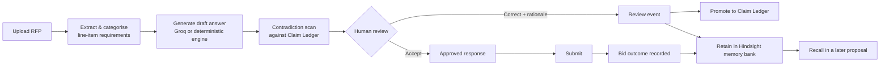

# PRECEDENT

> **Your organization's memory. Your next unfair advantage.**
> *Every bid builds a better next bid.*

PRECEDENT is an AI-native institutional intelligence platform for organisations that
routinely respond to enterprise RFPs, tenders, security questionnaires, and high-stakes
vendor assessments.

Traditional proposal tools store *what* was answered. PRECEDENT records *why* an answer
was changed, keeps verified commitments in a durable memory bank, blocks proposals that
contradict those commitments, and measures whether institutional memory actually improves
generated responses.

> **Status:** hackathon build, demo-ready. Built as a working full-stack application with
> automated tests and a one-click institutional-learning demonstration.

---

## Table of contents

1. [The problem](#the-problem)
2. [The solution](#the-solution)
3. [Core capabilities](#core-capabilities)
4. [How the institutional-memory workflow works](#how-the-institutional-memory-workflow-works)
5. [Human-in-the-loop review](#human-in-the-loop-review)
6. [Hindsight integration](#hindsight-integration)
7. [AI generation architecture](#ai-generation-architecture)
8. [Technology stack](#technology-stack)
9. [Project architecture](#project-architecture)
10. [Repository structure](#repository-structure)
11. [Installation and local setup](#installation-and-local-setup)
12. [Environment variables](#environment-variables)
13. [Running the frontend and backend](#running-the-frontend-and-backend)
14. [Demo](#demo)
15. [Synthetic demo data](#synthetic-demo-data)
16. [Known limitations](#known-limitations)
17. [Team](#team)

---

## The problem

Enterprise proposal teams lose institutional knowledge on every bid:

- Past answers are stored as static text, but the **reason** an answer was corrected is lost.
- New proposals accidentally re-introduce commitments that a human reviewer already rejected.
- Experience does not compound: every bid starts closer to zero than it should.
- Nothing stops a team from submitting a proposal that contradicts an approved corporate standard.

## The solution

PRECEDENT closes the loop between **generation**, **human review**, **memory**, and **outcomes**:

1. AI drafts evidence-grounded answers to extracted RFP requirements.
2. A human reviewer edits the draft and records a mandatory rationale.
3. The approved correction is promoted to a Claim Ledger and retained in the Hindsight memory bank.
4. A later, unrelated proposal recalls that approved precedent and reuses it.
5. A contradiction gate physically blocks submission while unresolved high-severity conflicts remain.
6. Bid outcomes and evaluator feedback are retained back into memory for the next cycle.

---

## Core capabilities

- **RFP parsing and document provenance** — line-item requirement extraction from `PDF`,
  `DOCX`, `DOC`, `TXT`, and `MD` documents, with section detection, category classification,
  and page references preserved.
- **AI proposal generation (Groq)** — evidence-grounded responses via `openai/gpt-oss-120b`
  (primary) and `openai/gpt-oss-20b` (fallback), returned as schema-validated JSON.
- **Deterministic offline engine** — if no Groq key is configured or the API is unreachable,
  PRECEDENT still produces schema-valid, domain-grounded response drafts.
- **Review and learning engine** — captures human edits with structured rationales and promotes
  approved statements into the Claim Ledger and the memory bank.
- **Hindsight institutional memory** — `retain`, `recall`, and `reflect` operations with
  client/sector isolation and durable SQLite persistence that survives restarts.
- **Contradiction defence and hard gate** — deterministic detection of conflicts between a draft
  proposal and approved commitments. Submission is blocked (HTTP `400`) while unresolved
  `HIGH`-severity contradictions remain.
- **Permanent contradiction audit trail** — every resolution (`ENFORCE_OLD`, `OVERRIDE_NEW`,
  `DISMISS`) is recorded with timestamp, user, action, and justification.
- **Memory ON vs Memory OFF A/B laboratory** — side-by-side execution of the same question with
  and without recalled memory, reporting *measured* deltas (character diff, recall latency,
  contradiction count), never fabricated percentages.
- **9-step institutional-learning demonstration** — an automated endpoint
  (`POST /api/demo/run-learning-cycle`) proving end-to-end retain → recall → reuse across two
  different proposals.
- **Audited analytics** — dashboard KPIs are computed directly from database records and clearly
  distinguish synthetic seed data from live data.

---

## How the institutional-memory workflow works



The memory loop is **retain → recall → reuse**:

- **Retain** — an approved correction is written to the memory bank with full provenance
  (source proposal, reviewer, rationale, scope, tags, client and sector).
- **Recall** — a new proposal query retrieves relevant memories using keyword/tag overlap scoring
  with strict client isolation (client-scoped concessions never leak to another client).
- **Reflect** — accumulated memories are synthesised into higher-level institutional insight,
  using Groq when available and a deterministic synthesis otherwise.

## Human-in-the-loop review

AI generation produces **drafts**, never institutional truth. A generated response starts in
`DRAFT` status and cannot enter the Claim Ledger or memory bank on its own:

- **Accept** (`POST /api/review/accept/{response_id}`) approves an answer without changes.
- **Correct** (`POST /api/review/correct`) captures the original answer, the corrected answer, a
  **mandatory** correction reason, a category tag, and the reviewer name. It then bumps the
  response version, creates a `ReviewCorrectionEvent`, adds a `HUMAN_APPROVED` item to the Claim
  Ledger, and — when `retain_in_hindsight` is set — retains the claim in the memory bank.

This human approval gate is a deliberate product principle and is covered by the test suite.

## Hindsight integration

Hindsight is the biomimetic memory engine that powers long-term institutional retention. In this
repository it is integrated as a **dual-path client** (`backend/app/services/hindsight.py`):

| State | Mode | Behaviour |
|-------|------|-----------|
| `CONNECTED` | `LIVE_EXTERNAL` | External Hindsight daemon reachable at `HINDSIGHT_API_URL/health`. Retain/recall/reflect proxy to it. |
| `FALLBACK` | `EMBEDDED_SQLITE_PERSISTENT` | External daemon unreachable. Operations run against the durable `memory_bank_records` table, surviving restarts. |

The service reports its state **honestly** through `GET /api/health` — a local fallback is never
presented as a live external connection. External API calls use the endpoints
`POST /v1/default/banks/{bank_id}/memories`, `.../memories/recall`, and `.../reflect`.

> In a default local setup there is no Hindsight daemon at `localhost:8888`, so PRECEDENT runs in
> the persistent SQLite fallback. This is expected and fully functional. See
> [`docs/HINDSIGHT_INTEGRATION.md`](docs/HINDSIGHT_INTEGRATION.md) for the full contract.

## AI generation architecture

The generation path (`backend/app/services/groq_engine.py`) is:

1. Recall approved precedents from the memory bank (only when `generation_mode == "MEMORY_ON"`).
2. Build a prompt that includes the question, category, client, sector, company facts, and any
   recalled precedents.
3. Call Groq with `response_format={"type": "json_object"}` on the primary model; on failure,
   retry once with the fallback model.
4. Validate the returned JSON against the expected response schema and persist it as a `DRAFT`.

If the Groq SDK client is unavailable, a deterministic fallback generator produces
domain-specific, schema-valid drafts (for support SLAs, data retention, disaster recovery, and a
general default). Both paths flow through the same contradiction scan and persistence logic.

---

## Technology stack

| Layer | Technology |
|-------|------------|
| Frontend | Next.js 15 (App Router), React 19, TypeScript, Tailwind CSS, Lucide icons |
| Backend | Python 3.12, FastAPI, Pydantic v2, Uvicorn |
| Persistence | SQLAlchemy 2 ORM — SQLite by default, PostgreSQL supported |
| AI inference | Groq (`openai/gpt-oss-120b`, fallback `openai/gpt-oss-20b`) + deterministic fallback |
| Memory engine | Hindsight REST (`retain`/`recall`/`reflect`) with durable SQLite fallback |
| Document parsing | `pypdf`, `python-docx` |

## Project architecture

PRECEDENT is a monorepo with a decoupled frontend and backend that communicate over a JSON REST
API:

- **Frontend** (`frontend/`) — Next.js App Router. A public marketing site sits at `/` and `/about`;
  the application shell (`/app`, `/proposals`, `/review`, `/contradictions`, `/lab`, `/memory`,
  `/claims`, `/outcomes`, `/clients`, `/analytics`, `/settings`) is the operational UI.
- **Backend** (`backend/`) — FastAPI app exposing routers for health, proposals, RFP ingestion,
  review, memory, contradictions, claims, outcomes, comparison, analytics, clients, and the demo
  cycle. Business logic lives in `backend/app/services/`.
- **Database** — SQLAlchemy models for proposals, questions, responses, review events, the claim
  ledger, contradiction alerts and audit logs, memory bank records, bid outcomes, clients, and
  sectors. Tables are created automatically at startup and a synthetic dataset is auto-seeded.

See [`docs/ARCHITECTURE.md`](docs/ARCHITECTURE.md) for the full component and data-flow breakdown.

## Repository structure

```
PRECEDENT/
├── backend/                  # FastAPI service
│   ├── app/
│   │   ├── config.py         # Settings loaded from .env (root or backend)
│   │   ├── database.py       # SQLAlchemy engine/session
│   │   ├── main.py           # App factory, CORS, router registration
│   │   ├── models/           # SQLAlchemy ORM models
│   │   ├── routers/          # API endpoints
│   │   ├── schemas/          # Pydantic request/response models
│   │   └── services/         # Groq engine, Hindsight, RFP parser, contradiction, seed
│   ├── tests/                # Pytest suite
│   ├── requirements.txt
│   └── main.py               # ASGI entrypoint (app.main:app)
├── frontend/                 # Next.js application
│   ├── src/
│   │   ├── app/              # Pages (public site + application shell)
│   │   ├── components/       # UI + public components
│   │   └── lib/api.ts        # Typed API client
│   ├── tests/                # Node test-runner suites
│   └── package.json
├── docs/                     # Architecture, testing, deployment, demo docs
├── scripts/                  # start.sh, test.sh
├── .env.example              # Environment template
├── render.yaml               # Render backend blueprint
└── vercel.json               # Vercel frontend/backend services
```

## Installation and local setup

Full, verified instructions live in [`docs/DEVELOPMENT.md`](docs/DEVELOPMENT.md). The short version:

```bash
# 1. Backend
cd backend
python3.12 -m venv .venv
source .venv/bin/activate
pip install -r requirements.txt
PYTHONPATH=. uvicorn app.main:app --reload --port 8000

# 2. Frontend (in a second terminal)
cd frontend
npm install          # or: pnpm install
npm run dev
```

- Backend API: `http://localhost:8000`
- Interactive API docs: `http://localhost:8000/docs`
- Frontend: `http://localhost:3000`

## Environment variables

Copy the template and fill in what you need:

```bash
cp .env.example .env
```

| Variable | Required | Default | Purpose |
|----------|----------|---------|---------|
| `GROQ_API_KEY` | No | *(empty)* | Enables live Groq inference. Without it, the deterministic engine is used. |
| `GROQ_MODEL` | No | `openai/gpt-oss-120b` | Primary inference model. |
| `GROQ_FALLBACK_MODEL` | No | `openai/gpt-oss-20b` | Fallback inference model. |
| `HINDSIGHT_API_URL` | No | `http://localhost:8888` | External Hindsight daemon base URL. |
| `HINDSIGHT_API_KEY` | No | *(empty)* | Bearer token for an authenticated Hindsight instance. |
| `HINDSIGHT_BANK_ID` | No | `precedent-institutional-memory` | Target memory bank. |
| `DATABASE_URL` | No | `sqlite:///./precedent.db` | SQLAlchemy connection string (SQLite or PostgreSQL). |
| `BACKEND_HOST` / `BACKEND_PORT` / `PORT` | No | `0.0.0.0` / `8000` | Server binding. |
| `ENVIRONMENT` | No | `development` | `production` hardens errors and CORS. |
| `LOG_LEVEL` | No | `INFO` | Logging verbosity. |
| `CORS_ORIGINS` | No | localhost | Comma-separated allowed frontend origins. |
| `NEXT_PUBLIC_API_URL` | No | `/api` | Frontend API base (full URL for standalone local dev, e.g. `http://localhost:8000/api`). |
| `NEXT_PUBLIC_APP_NAME` | No | `PRECEDENT` | Display name. |
| `DEFAULT_ORGANIZATION_ID` | No | `org_precedent_demo` | Single-tenant demo organisation scope. |
| `SECRET_KEY` | No | dev default | Signing secret. Set a strong value in production. |
| `UPLOAD_DIR` | No | `uploads` | Upload directory (uploads are parsed in-memory and not persisted). |

> **Never** place secrets in any `NEXT_PUBLIC_*` variable — those are embedded in the client bundle.

## Running the frontend and backend

- **Manual:** use the commands in [Installation and local setup](#installation-and-local-setup).
- **Startup script:** `./scripts/start.sh` starts both services. It expects a Python virtual
  environment at `backend/.venv` and the frontend package manager `pnpm`.
- **Full verification:** `./scripts/test.sh` runs the backend pytest suite, the frontend
  regression tests, TypeScript type-checking, and a production build.

## Demo

The recommended walkthrough is in [`docs/DEMO_GUIDE.md`](docs/DEMO_GUIDE.md). A shorter narrative
is in [`docs/DEMO_SCRIPT.md`](docs/DEMO_SCRIPT.md).

The end-to-end learning cycle can also be exercised headlessly:

```bash
curl -X POST http://localhost:8000/api/demo/run-learning-cycle
```

This returns a step-by-step timeline proving an approved correction from one proposal is recalled
and reused in a second proposal.

## Synthetic demo data

On first startup the backend auto-seeds a **fictional** dataset for a made-up vendor
("Vanguard Logic Systems"), its sectors, three clients, a claim ledger, two historical proposals
with outcomes, and an in-review proposal with a deliberate contradiction. This data exists purely
to make the product demonstrable out of the box. It contains no real customers, metrics, or
certifications. Use `POST /api/seed?force=true` to re-seed, and note that analytics explicitly
label synthetic records.

There are no screenshots committed to this repository; run the app locally to view the UI.

## Known limitations

- **No authentication layer.** The `SECRET_KEY` and `DEFAULT_ORGANIZATION_ID` exist, but there is
  no user login or authorisation middleware. PRECEDENT is a single-tenant demo, not a
  multi-tenant production service.
- **Contradiction detection is deterministic.** It uses a fixed set of regex rules over known
  claim subjects (support coverage, data retention, uptime, disaster recovery), not general
  semantic contradiction detection.
- **Memory recall is a keyword/tag scoring surrogate** in fallback mode, not vector embeddings.
  Semantic quality depends on the external Hindsight daemon being connected.
- **Groq is optional.** Without `GROQ_API_KEY`, responses come from a deterministic, templated
  fallback engine covering a limited set of domains.
- **Uploads are parsed in memory** and are not stored to disk.
- **SQLite is the default** store; concurrent multi-worker writes are not recommended without
  migrating to PostgreSQL.
- **Analytics mix synthetic and live data**, clearly labelled via metric provenance, and some KPIs
  fall back to documented heuristics when few live responses exist.

## Team

PRECEDENT was built for a hackathon by the PRECEDENT team. Contributors from the repository
history:

- **Shriyash** — backend, integrations, deployment
- **Aarushi Singh** — QA, regression tests, documentation

See [`docs/`](docs) for architecture, testing, deployment, and demo documentation.
