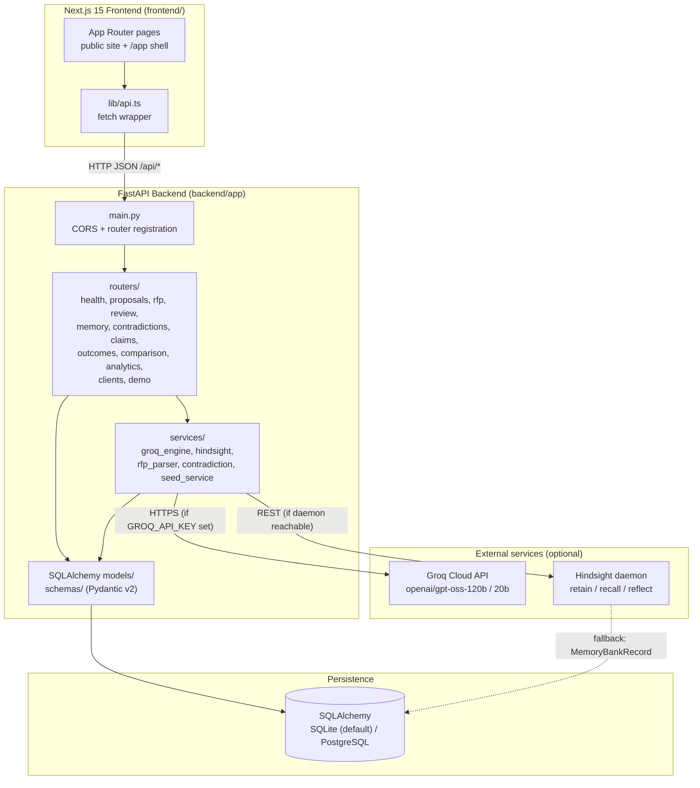

# PRECEDENT — Architecture

This document describes the architecture that is actually implemented in this repository. It is
derived from the source under `backend/` and `frontend/`.

---

## 1. System overview

PRECEDENT is a monorepo with a Next.js frontend, a FastAPI backend, a relational database, and two
optional external services (Groq for inference, Hindsight for memory). The frontend talks to the
backend over a JSON REST API.

---

## 2. Frontend architecture

- **Framework:** Next.js 15 App Router with React 19 and TypeScript.
- **Public site:** `/` (landing) and `/about` are composed from `frontend/src/components/public/`.
- **Application shell:** `frontend/src/components/AppShell.tsx` provides the sidebar + header layout
  used by the operational routes.
- **Routes (pages under `frontend/src/app/`):**

  | Route | Purpose |
  |-------|---------|
  | `/app` | Overview dashboard |
  | `/proposals` | Proposal workspace list |
  | `/proposals/upload` | RFP ingestion |
  | `/proposals/[id]` | Proposal detail / generation / submit |
  | `/review` | Human-in-the-loop review and retain |
  | `/contradictions` | Contradiction centre and audit trail |
  | `/lab` | Memory ON vs OFF A/B laboratory |
  | `/memory` | Institutional memory explorer |
  | `/claims` | Claim ledger |
  | `/outcomes` | Bid outcome intelligence |
  | `/clients` | Clients and sectors |
  | `/analytics` | Audited metrics |
  | `/settings` | Health and configuration |

- **API client:** `frontend/src/lib/api.ts` centralises all HTTP calls. It normalises the base URL:
  server-side rendering uses the Vercel service binding (`PRECEDENT_API_URL`), the browser uses
  `NEXT_PUBLIC_API_URL` (default `/api`), and standalone local development falls back to
  `http://localhost:8000/api`. It surfaces structured backend error details and adds a helpful
  message when a Render free-tier cold start drops the connection.

---

## 3. Backend architecture

- **Framework:** FastAPI (ASGI, Uvicorn). Entrypoint `backend/app/main.py` exposes `app`.
- **Startup:** the `lifespan` handler creates all tables via `Base.metadata.create_all` and
  auto-seeds the synthetic dataset if the database is empty.
- **CORS:** an explicit allowlist is parsed from `CORS_ORIGINS`; localhost origins are appended
  automatically in non-production.
- **Error handling:** a global exception handler returns generic messages in production and full
  detail in development.
- **Readiness:** `GET /ready` and `GET /api/ready` are provided for zero-downtime deploys.
- **Layering:**
  - `routers/` — HTTP endpoints and request orchestration.
  - `services/` — domain logic (Groq generation, Hindsight memory, RFP parsing, contradiction
    detection, seeding).
  - `models/` — SQLAlchemy ORM models.
  - `schemas/` — Pydantic v2 request/response models.
  - `config.py` — settings loaded from `.env` (searched in the repo root, `backend/`, then the CWD).
  - `database.py` — engine/session factory; rewrites `postgres://` to `postgresql://` for SQLAlchemy 2.

### API surface

| Method | Path | Description |
|--------|------|-------------|
| `GET` | `/`, `/ready`, `/api/ready` | Root metadata and readiness |
| `GET` | `/api/health` | DB, memory, and Groq status |
| `GET`/`POST` | `/api/proposals` | List / create proposals |
| `GET` | `/api/proposals/{id}` | Proposal detail with questions and responses |
| `POST` | `/api/proposals/generate-response` | Generate an answer for a question |
| `POST` | `/api/proposals/{id}/submit` | Submit (blocked on open HIGH contradictions) |
| `POST` | `/api/rfp/ingest` | Upload and parse an RFP document |
| `POST` | `/api/review/correct` | Submit a reviewer correction and retain it |
| `POST` | `/api/review/accept/{response_id}` | Accept a response unchanged |
| `POST` | `/api/memory/retain` \| `/recall` \| `/reflect` | Memory operations |
| `GET` | `/api/memory/explorer` | Provenance feed of review events + bank memories |
| `GET` | `/api/contradictions` | List contradiction alerts |
| `POST` | `/api/contradictions/{alert_id}/resolve` | Resolve an alert |
| `GET` | `/api/contradictions/audit-trail` | Permanent resolution audit log |
| `GET`/`POST` | `/api/claims` | List / create claim ledger items |
| `POST` | `/api/claims/{claim_id}/deactivate` | Deactivate a claim |
| `GET`/`POST` | `/api/outcomes` | List / record bid outcomes |
| `POST` | `/api/comparison/execute` | Run Memory ON vs OFF comparison |
| `GET` | `/api/analytics/summary` | Audited metrics + query provenance |
| `GET` | `/api/clients`, `/api/sectors`, `/api/company-profile` | Reference data |
| `POST` | `/api/seed` | Re-seed synthetic data |
| `GET` | `/api/demo/scenario-status` | Demo readiness |
| `POST` | `/api/demo/run-learning-cycle` | Execute the 9-step learning cycle |

Interactive docs are served at `/docs`.

---

## 4. API communication

The frontend uses a single `fetchApi` wrapper. All endpoints are relative to the normalised API
base. RFP ingestion is the only call that sends `multipart/form-data` (via `FormData`); everything
else sends JSON. The wrapper throws `Error` instances carrying the backend's `detail` message,
which the UI surfaces to the user.

---

## 5. Document ingestion

`backend/app/services/rfp_parser.py` validates and parses uploads:

- **Validation:** rejects empty files, files over **25 MB**, and any extension outside
  `{.pdf, .docx, .doc, .txt, .md}` (the ingestion router additionally blocks `.md`).
- **Extraction:** `pypdf` for PDFs (per-page text is kept for page references) and `python-docx`
  for DOCX (paragraphs plus table cells). TXT/MD are decoded directly.
- **Structure:** numbered/bulleted lines, trailing question marks, and "describe/provide" phrases are
  treated as requirements. Section headers are tracked, categories are assigned by keyword, a
  deadline is regex-detected, and a page reference is preserved where possible.

The ingestion router (`routers/rfp.py`) creates a `Proposal` in `DRAFT` status and one
`RfpQuestion` row per extracted requirement.

## 6. RFP/question extraction

Each extracted requirement is stored with `section`, `question_text`, `category`, `is_mandatory`,
`required_evidence`, `evaluation_criteria`, and `page_reference`. Categories map to a fixed
enumeration (Company Information, Product Capabilities, Technical Architecture, Security,
Compliance, Data Privacy, SLAs and Support, Implementation, Pricing and Commercial Terms,
Experience and Case Studies, Other).

## 7. AI answer generation

`routers/proposals.py` orchestrates generation for a single question:

1. **Recall (MEMORY_ON only):** `hindsight_service.recall` fetches up to 4 relevant precedents,
   scoped by client and sector.
2. **Generate:** `groq_proposal_engine.generate_response` builds a prompt with the question,
   category, client, sector, company facts, and recalled precedents, then calls Groq with a JSON
   response format on the primary model, retrying once with the fallback model. If the Groq client
   is unavailable, a deterministic domain-specific fallback produces a schema-valid draft.
3. **Contradiction scan:** the generated text is checked against the Claim Ledger.
4. **Persist:** a `ProposalResponse` is stored in `DRAFT` status with confidence score, sources,
   recalled precedents, latency, and generation mode.

## 8. Human review

`routers/review.py` implements the approval gate. `POST /api/review/correct` requires a non-empty
correction reason (enforced at the API schema level and in the UI), creates a
`ReviewCorrectionEvent`, updates the response to `EDITED` and bumps its version, optionally retains
the corrected claim in the memory bank, and appends a `HUMAN_APPROVED` `ClaimLedgerItem`.
Accepting a response sets it to `ACCEPTED` and clears `verification_required`.

## 9. Memory retention

Retention is handled by `hindsight_service.retain`. Every retained memory is **always** written to
the `memory_bank_records` table for durable, auditable persistence; when the external Hindsight
daemon is reachable, the content is also posted to it. Records carry full provenance: bank id,
content, context, fact type, source proposal/review/question, client, sector, scope, approver,
approval status, reviewer rationale, tags, entities, and metadata.

## 10. Recall

`hindsight_service.recall` first attempts the external daemon. In fallback mode it loads active
records for the bank and scores them by query-term overlap, tag overlap, and a sector match bonus,
then returns the top `limit` results. **Client isolation** is strict: a record carrying a
`client_id` is only returned when the request's `client_id` matches. Each result includes the
combined provenance metadata.

## 11. Reflection

`hindsight_service.reflect` synthesises higher-level insight. It prefers the external daemon; in
fallback it ranks stored memories against the query and, if Groq is live, asks the model for a
2–3 paragraph institutional reflection; otherwise it returns a deterministic synthesis. The
response includes the memories used, generated "mental models", and a strategic recommendation.

## 12. Hindsight integration

The Hindsight client uses these external contracts:

- `POST /v1/default/banks/{bank_id}/memories`
- `POST /v1/default/banks/{bank_id}/memories/recall`
- `POST /v1/default/banks/{bank_id}/reflect`
- `GET /health` for connectivity checks

The service exposes `CONNECTED`/`FALLBACK` state honestly via `/api/health`. See
[`HINDSIGHT_INTEGRATION.md`](HINDSIGHT_INTEGRATION.md) for the detailed contract.

## 13. Database / storage

SQLAlchemy 2 ORM. Default engine is SQLite (`sqlite:///./precedent.db`); PostgreSQL is supported and
`postgres://` URLs are normalised to `postgresql://`. Non-SQLite engines use `pool_pre_ping` with a
pool size of 10 and overflow of 20.

Core tables:

| Table | Model | Purpose |
|-------|-------|---------|
| `clients`, `sectors`, `company_profile` | `Client`, `Sector`, `CompanyProfile` | Reference data and approved company facts |
| `proposals` | `Proposal` | RFP workspaces |
| `rfp_questions` | `RfpQuestion` | Extracted requirements |
| `proposal_responses` | `ProposalResponse` | Generated/edited answers and metadata |
| `review_correction_events` | `ReviewCorrectionEvent` | Human corrections with rationale |
| `claim_ledger` | `ClaimLedgerItem` | Verified corporate commitments |
| `contradiction_alerts` | `ContradictionAlert` | Detected conflicts |
| `contradiction_audit_logs` | `ContradictionAuditLog` | Immutable resolution history |
| `memory_bank_records` | `MemoryBankRecord` | Durable memory storage |
| `bid_outcomes` | `BidOutcome` | Win/loss outcomes and feedback |

Foreign keys use `ondelete="CASCADE"` and ORM relationships use `cascade="all, delete-orphan"`.

## 14. Contradiction detection

`services/contradiction.py` holds a fixed rule set covering four subjects (enterprise support
coverage, data retention, uptime SLA, disaster recovery). Each rule pairs an approved value with
regex conflict patterns. `scan_for_conflicts` evaluates draft text against the rules and against
active claim-ledger items (respecting client scope), de-duplicates against existing open alerts,
and persists `HIGH`-severity `ContradictionAlert` rows.

Resolution (`resolve_alert`) transitions the alert to `RESOLVED_ENFORCED_OLD`,
`RESOLVED_OVERRIDDEN_NEW`, or `DISMISSED` and writes an immutable `ContradictionAuditLog`. Choosing
`ENFORCE_OLD` also rewrites the most recent response to the approved precedent text.

**Hard gate:** `POST /api/proposals/{id}/submit` returns HTTP `400` with a structured payload while
any `HIGH`-severity alert is still `OPEN`. Once resolved, submission sets the proposal to
`SUBMITTED`.

## 15. Outcomes and feedback

`routers/outcomes.py` records one `BidOutcome` per proposal (upsert on re-record). When evaluator
feedback is present, a summary is retained back into the memory bank with tags for the outcome and
primary reason, closing the loop between commercial results and generation.

## 16. Analytics and measurement

`routers/analytics.py` computes every KPI directly from database queries and returns a
`query_auditing` map plus `metric_provenance` that distinguishes live-measured metrics from
synthetic demo history. The Memory ON vs OFF comparison (`routers/comparison.py`) runs the same
question twice and reports measured deltas — recalled precedent count, contradiction delta,
consistency delta, unsupported-claim delta, text similarity ratio, reviewer characters saved,
recall latency, and a descriptive empirical finding (`CONTRADICTION_PREVENTED`,
`CONSISTENCY_IMPROVED`, or `NEUTRAL`). No percentage improvement is fabricated.

---

## Design principles enforced in code

1. **AI output is a draft, not truth.** Generated responses start as `DRAFT` and only enter the
   ledger/memory after human approval.
2. **Contradictions block submission.** Unresolved `HIGH` conflicts return HTTP `400`.
3. **Client data is quarantined.** Client-scoped memories and claims never leak across clients.
4. **Honest status reporting.** Memory mode is reported as `CONNECTED` or `FALLBACK`, and metrics
   disclose their provenance.
