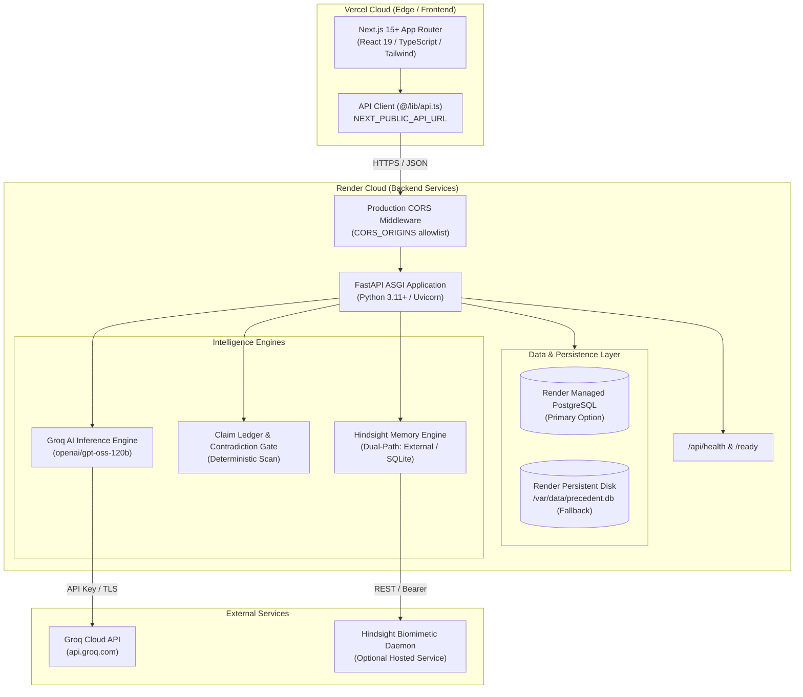

# PRECEDENT — Deployment Architecture Specification

**Product:** PRECEDENT — AI-Native Institutional Intelligence Platform for Proposals & RFPs  
**Target Infrastructure:** Render (Backend API + Database) & Vercel (Frontend Next.js)  
**Repository:** `https://github.com/shriyashthechamp-hash/PRECEDENT.git`  
**Current Branch:** `main`  

---

## 1. System Architecture Overview

---

## 2. Directory & Component Mapping

| Component | Repository Path | Technology Stack | Deployment Target |
|---|---|---|---|
| **Frontend Application** | `/frontend` | Next.js 15.1.7, React 19, TypeScript 5.6, Tailwind CSS 3.4, Lucide Icons | Vercel |
| **Backend API Service** | `/backend` | Python 3.11+, FastAPI 0.110+, SQLAlchemy 2.0+, Uvicorn 0.28+, Pydantic v2 | Render Web Service |
| **Relational Database** | `DATABASE_URL` | Render Managed PostgreSQL (or SQLite on Persistent Disk) | Render Postgres / Disk |
| **Package Managers** | `frontend/pnpm-lock.yaml`, `backend/requirements.txt` | pnpm 9+ (Node.js), pip / venv (Python) | Vercel & Render builders |
| **API Entrypoint** | `backend/app/main:app` | FastAPI Application Instance with lifespan context manager | Render Start Command |

---

## 3. Database Strategy: PostgreSQL vs Persistent Disk

### Primary Strategy: Render Managed PostgreSQL (Recommended)
- **Engine:** PostgreSQL 16+ on Render.
- **Connection Protocol:** `DATABASE_URL` environment variable provided automatically by Render.
- **URL Handling:** Render emits `postgres://...` URLs; PRECEDENT automatically normalizes to `postgresql://...` for SQLAlchemy 2.0+ compatibility with `psycopg2-binary`.
- **Concurrency:** Multi-worker Uvicorn configurations, pooling with `pool_pre_ping=True`, and zero SQLite file lock contention.
- **Model Compatibility:** All models in `backend/app/models/` use standard SQLAlchemy column types (`String`, `Integer`, `Float`, `Boolean`, `DateTime`, `Text`, `JSON`, `ForeignKey`). Both SQLite and PostgreSQL are natively supported without dialect collisions.

### Fallback Strategy: Render Persistent Disk (SQLite)
- **Mount Path:** `/var/data`
- **Database Path:** `/var/data/precedent.db`
- **Configuration:** Set `DATABASE_URL=sqlite:////var/data/precedent.db`.
- **Constraint:** Must run single-worker Uvicorn (`--workers 1`) to prevent SQLite multi-process write locks.

---

## 4. Network, Security & CORS Architecture

### Ingress & Protocol Security
- All external client traffic routes over HTTPS/TLS 1.3 to Vercel and Render.
- Backend runs behind Render's reverse proxy terminating TLS, binding internally to `0.0.0.0:${PORT}`.

### Production CORS Allowlist
Wildcard origins (`*`) with credentials are strictly prohibited in production.
- **Allowed Origins:** Controlled via `CORS_ORIGINS` environment variable.
- **Default Development:** `http://localhost:3000,http://127.0.0.1:3000`.
- **Production Setting:** `https://your-precedent-frontend.vercel.app,https://your-custom-domain.com`.

### File Upload & Storage Security
- Ingested RFP documents (`.pdf`, `.docx`) are parsed in-memory using `pypdf` and `python-docx`.
- File uploads are validated:
  - Allowed extensions: `.pdf`, `.docx`, `.doc`, `.txt`.
  - Max upload size: 25 MB.
  - Uploaded files are not permanently stored in ephemeral filesystem; all extracted questions, sections, and metadata are persisted immediately to the database.

---

## 5. Intelligence Engine Resilience

### Groq AI Inference
- Communicates via HTTPS to `api.groq.com`.
- Primary model: `openai/gpt-oss-120b` (120B parameter flagship).
- Resilient fallback: `openai/gpt-oss-20b` (low-latency fallback).
- Deterministic heuristic engine: If external Groq API is temporarily unreachable or unconfigured, PRECEDENT executes high-fidelity deterministic proposal synthesis adhering to verified schemas.

### Hindsight Institutional Memory
- External Hindsight endpoint configurable via `HINDSIGHT_API_URL` and `HINDSIGHT_API_KEY`.
- If external Hindsight is deployed (e.g., containerized on Render or external host), PRECEDENT executes live Retain, Recall, and Reflect operations.
- If external Hindsight is not present or offline, PRECEDENT automatically and transparently operates in `EMBEDDED_SQLITE` fallback mode, storing verified precedents in `MemoryBankRecord` with 100% provenance and zero data loss.

